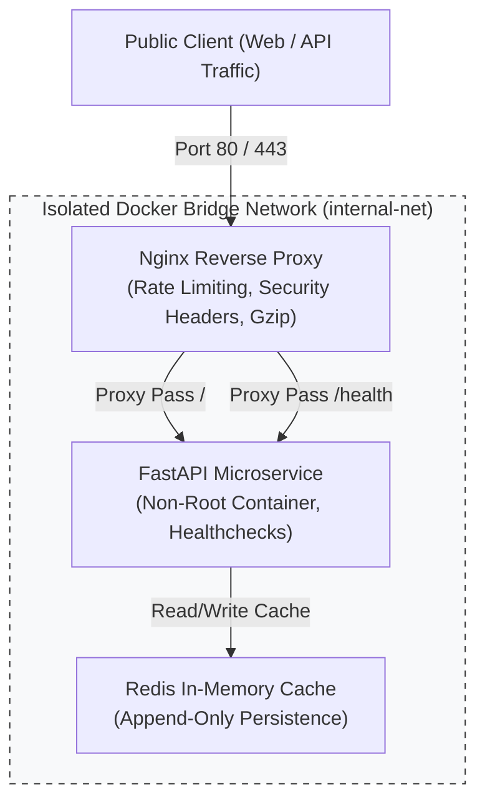

# Containerized Edge Gateway & Microservice Stack

[](https://lab.euprac.xyz)
[](https://lab.euprac.xyz)
[](https://github.com/jobin-jr/cloud-devops-lab)

A production-grade, containerized infrastructure stack engineered for high-availability, automated deployment, and security hardening. Built with Docker Compose, Nginx, FastAPI, and Redis.

**Live Production Edge:** [https://lab.euprac.xyz](https://lab.euprac.xyz)  
* **Healthcheck:** `https://lab.euprac.xyz/health`
* **Metrics API:** `https://lab.euprac.xyz/api/v1/metrics`

---

## 🏛️ System Architecture



---

## 🚀 Key Architectural Highlights

1. **Edge Reverse Proxy (Nginx):**
   * **Security Hardening:** Enforces `SAMEORIGIN`, `nosniff`, `XSS-Protection`, and `Referrer-Policy` headers.
   * **DDoS & Brute-Force Protection:** Enforces per-IP rate limiting (10 requests/sec with burst buffer) via `limit_req_zone`.
   * **Performance:** Gzip dynamic compression enabled for JSON, CSS, and JavaScript payloads.
2. **Hardened Application Layer:**
   * Runs as unprivileged non-root user (`appuser`, UID 1000) inside a minimal Python 3.11-slim base image.
   * Native Docker health check monitoring (`/health`) with automatic restart policies (`restart: unless-stopped`).
   * Explicit resource constraints applied (`cpus: 0.50`, `memory: 256M`).
3. **Network Isolation:**
   * The Redis cache and backend API have **zero public host ports bound**. They communicate strictly over an internal Docker bridge network (`internal-net`).
4. **Automated Operations & Disaster Recovery:**
   * **Zero-Downtime Deployment:** [`scripts/deploy.sh`](scripts/deploy.sh) runs a pre-flight healthcheck loop and automatically rolls back if health probes fail.
   * **Automated Backup & Checksums:** [`scripts/backup.sh`](scripts/backup.sh) generates timestamped tarball archives, calculates SHA256 cryptographic hashes, and rotates archives older than 7 days.

---

## 🛠️ Quickstart (Running Locally)

### Prerequisites
* Docker Engine 24.0+ and Docker Compose v2.0+
* Git

### 1. Clone & Configure
```bash
git clone https://github.com/jobin-jr/cloud-devops-lab.git
cd cloud-devops-lab
cp .env.example .env
```

### 2. Deploy the Stack
```bash
chmod +x scripts/*.sh
./scripts/deploy.sh
```

### 3. Verify Health
Visit `http://localhost/health` in your browser or run:
```bash
curl -i http://localhost/health
```

Expected Response:
```json
{
  "status": "healthy",
  "system": {
    "os": "Linux",
    "python_version": "3.11.x"
  }
}
```

---

## 🔒 Security Hardening Matrix

| Security Control | Implementation | Purpose |
| :--- | :--- | :--- |
| **Non-Root Execution** | `USER appuser` (UID 1000) | Prevents container-breakout attacks from gaining host root access. |
| **Port Minimization** | Only port `80` exposed to host | Protects internal Redis cache and backend API from public port scanning. |
| **Rate Limiting** | Nginx `limit_req_zone` (10r/s) | Mitigates Layer 7 denial of service and API abuse. |
| **Resource Quotas** | Compose `deploy.resources.limits` | Prevents noisy-neighbor memory exhaustion crashes. |
| **Checksum Verification** | SHA256 integrity files | Guarantees disaster recovery backups are not corrupted or tampered with. |

---

## 👨‍💻 Engineer

**Jobin J R**  
*Linux Systems Administrator & Network Operations*  
*Founder, InPrac Network*
