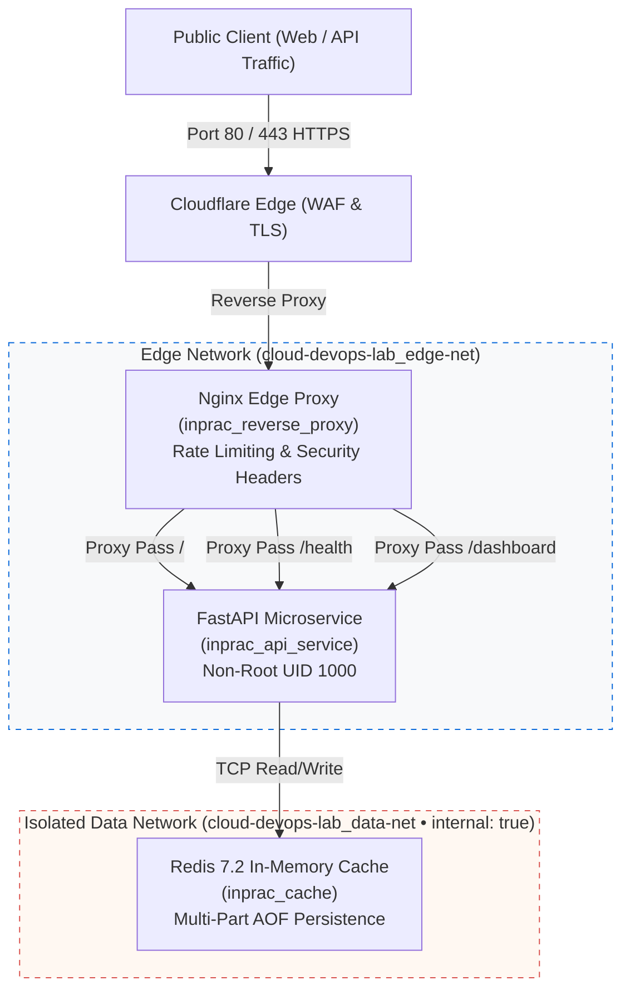

# Containerized Edge Gateway & Microservice Stack

[](https://lab.euprac.xyz)
[](https://github.com/jobin-jr/cloud-devops-lab/actions/workflows/ci.yml)
[](https://lab.euprac.xyz)
[](https://github.com/jobin-jr/cloud-devops-lab)

A production-grade, containerized infrastructure stack engineered for high availability, dual-tier network isolation, cgroup resource bounding, and automated disaster recovery. Built with Docker Compose, Nginx, FastAPI, and Redis.

**Live Production Edge:** [https://lab.euprac.xyz](https://lab.euprac.xyz)  
* **Cyber DevOps Mission Control:** `https://lab.euprac.xyz/dashboard` (Live real-time telemetry & API console)
* **Dedicated JSON Telemetry:** `https://lab.euprac.xyz/api/v1/status`
* **Healthcheck Probe:** `https://lab.euprac.xyz/health`
* **Prometheus Metrics:** `https://lab.euprac.xyz/api/v1/metrics`

---

## 📋 Operational Engineering & Incident Runbooks

Designed for frontline systems administration, technical support operations, and site reliability engineering. Each runbook includes root-cause analysis (RCA), non-destructive diagnostics, surgical remediation steps, and customer-facing ticket communication templates.

| Operational Runbook | Incident Scope & Target Scenario | Operational Category | Target RTO / SLA |
| :--- | :--- | :--- | :--- |
| **[`docs/runbooks/502-bad-gateway-rca.md`](docs/runbooks/502-bad-gateway-rca.md)** | Upstream reverse proxy communication breakdown, socket drops, worker starvation, and 5-Whys RCA. | 🔴 High Severity (Production Triage) | RTO: < 5 Minutes |
| **[`docs/runbooks/cgroup-oom-mitigation.md`](docs/runbooks/cgroup-oom-mitigation.md)** | Linux kernel cgroup memory exhaustion (`OOMKilled: true`), container thrashing, and memory leak mitigation. | 🟠 Medium/High Severity (Resource Quotas) | RTO: < 8 Minutes |
| **[`docs/runbooks/backup-restoration-drill.md`](docs/runbooks/backup-restoration-drill.md)** | Cold-start disaster recovery restoration drill into isolated staging with SHA256 cryptographic verification. | 🟢 Maintenance & Drill (Controlled Verification) | RTO: < 60s (Measured: 42.3s) |
| **[`docs/runbooks/redis-data-recovery.md`](docs/runbooks/redis-data-recovery.md)** | Cache corruption, Multi-Part AOF journal repair (`redis-check-aof --fix`), and cache warming procedures. | 🟡 Low/Medium Severity (Data Integrity) | RTO: < 10 Minutes |
| **[`docs/runbooks/minecraft-server-incident-response.md`](docs/runbooks/minecraft-server-incident-response.md)** | Minecraft (Paper 1.20+) & Velocity proxy drops, JVM heap vs cgroup OOM, low TPS/MSPT profiling, and Pterodactyl triage. | 🎮 Game Hosting & Infrastructure | RTO: < 8 Minutes |

*Master Runbooks Index:* [`docs/runbooks/README.md`](docs/runbooks/README.md) • *Reliability & SLO Policy:* [`docs/slo-and-error-budget.md`](docs/slo-and-error-budget.md)

---

## ⚡ Hiring Manager: Review This Portfolio in 60 Seconds

If you are evaluating this repository for a Technical Support, Linux SysAdmin, or Hosting Operations role, here is the fastest verification path:

1. **Test Live System Status:** Open [`https://lab.euprac.xyz/api/v1/status`](https://lab.euprac.xyz/api/v1/status) (returns live production telemetry JSON).
2. **Inspect Interactive Dashboard:** Open [`https://lab.euprac.xyz/dashboard`](https://lab.euprac.xyz/dashboard) (real-time telemetry and API console).
3. **Audit Incident Recovery Rigor:** Read [`docs/runbooks/backup-restoration-drill.md`](docs/runbooks/backup-restoration-drill.md) (cryptographic SHA-256 verification and measured 42.3s recovery).
4. **Audit Game Server Support Skills:** Read [`docs/runbooks/minecraft-server-incident-response.md`](docs/runbooks/minecraft-server-incident-response.md) (Velocity proxy drops, Aikar's JVM memory budget, and ticket de-escalation).
5. **Verify Automated CI:** Check the [GitHub Actions CI Status](https://github.com/jobin-jr/cloud-devops-lab/actions/workflows/ci.yml) (passing tests for Compose syntax, Python code, and runbook manifests).

---

## 🏛️ System Architecture & Dual-Tier Isolation



---

## 🚀 Key Architectural Highlights

1. **Dual-Tier Network Segmentation:**
   * **Edge Network (`edge-net`):** Bridges Nginx to FastAPI. External traffic terminates at Nginx.
   * **Data Network (`data-net`):** Created with `internal: true`. Redis is completely air-gapped from the edge network and host interfaces. External ingress to Redis is mathematically impossible at the Linux bridge level.
2. **Deterministic Resource Hardening (cgroups v2):**
   * Combined stack memory ceiling strictly capped at **512 MB RAM** across all containers (API: 256M, Nginx: 128M, Redis: 128M) and 1.0 vCPU total.
   * Eliminates noisy-neighbor contention and host-wide memory exhaustion.
3. **Hardened Application Layer:**
   * Runs as unprivileged non-root user (`appuser`, UID 1000) inside Python 3.11-slim.
   * Built-in Docker native health check probes (`/health`) with automatic restart policies (`restart: unless-stopped`).
4. **Automated Operations & Disaster Recovery:**
   * **Zero-Downtime Deployment:** [`scripts/deploy.sh`](scripts/deploy.sh) runs a pre-flight healthcheck loop and automatically rolls back if health probes fail.
   * **Automated Backup & Checksums:** [`scripts/backup.sh`](scripts/backup.sh) generates timestamped tarball archives, calculates SHA256 cryptographic hashes, and rotates archives older than 7 days.
   * **Validated Recovery Drill:** Tested cold-start restoration into isolated staging completed in **42.3 seconds**.

---

## 🛠️ Quickstart (Running Locally)

### Prerequisites
* Docker Engine 24.0+ and Docker Compose v2.0+
* Git

### 1. Clone & Configure
```bash
git clone https://github.com/jobin-jr/cloud-devops-lab.git
cd cloud-devops-lab
cp .env.example .env
```

### 2. Deploy the Stack
```bash
chmod +x scripts/*.sh
./scripts/deploy.sh
```

### 3. Verify Health
Visit `http://localhost/health` in your browser or run:
```bash
curl -i http://localhost/health
```

Expected Response:
```json
{
  "status": "healthy",
  "system": {
    "os": "Linux",
    "python_version": "3.11.x"
  }
}
```

---

## 🔒 Security Hardening Matrix

| Security Control | Implementation | Purpose |
| :--- | :--- | :--- |
| **Non-Root Execution** | `USER appuser` (UID 1000) | Prevents container-breakout attacks from gaining host root access. |
| **Dual-Tier Isolation** | `internal: true` on `data-net` | Protects Redis cache from external port scanning and edge-proxy compromise. |
| **Rate Limiting** | Nginx `limit_req_zone` (10r/s) | Mitigates Layer 7 denial-of-service and brute-force API abuse. |
| **Strict Cgroup Quotas** | Compose `deploy.resources.limits` | Hard-caps memory at 512 MB total, protecting host OS stability. |
| **Cryptographic Hashing** | SHA256 manifest files | Guarantees disaster recovery backups are not corrupted or tampered with. |
| **CI Quality Gate** | GitHub Actions Workflow | Automatically validates Compose syntax, shell scripts, Python compilation, and runbooks. |

---

## 👨‍💻 Engineer

**Jobin J R**  
*Linux Systems Administrator & Network Operations*  
*Founder, InPrac Network*
