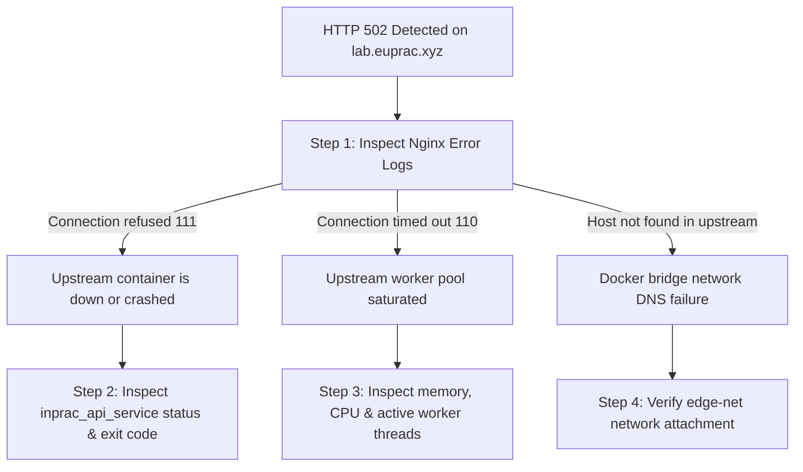

# Operational Runbook: 502 Bad Gateway Triage & RCA

**Runbook Identifier:** `RB-NET-502`  
**Target Architecture:** Nginx Reverse Proxy & FastAPI Core Microservice  
**Default Host Network:** `cloud-devops-lab_edge-net`  
**Severity Level:** 🔴 P1 (Service Disruption)  
**Target Recovery Time Objective (RTO):** < 5 Minutes  

---

## 1. Incident Overview & Trigger Symptoms

A client attempting to access `https://lab.euprac.xyz/` receives an `HTTP 502 Bad Gateway` error or an empty upstream response.

```text
HTTP/1.1 502 Bad Gateway
Server: cloudflare (or nginx)
Content-Type: application/json
{"error":"Service Temporarily Unavailable","status":502}
```

### Underlying Mechanism
An `HTTP 502` indicates that Nginx (`inprac_reverse_proxy`) is acting as an edge reverse proxy but received an invalid response, connection refusal, or network failure when attempting to forward the request to the upstream application service (`inprac_api_service:8000`).

---

## 2. Initial Safety Precaution

> [!WARNING]
> **DO NOT restart the host server or kill the entire Docker daemon.**  
> A broad reboot destroys runtime container logs, drops active TLS sessions, and risks interrupting other services on the host. Follow the surgical diagnostic tree below.

---

## 3. Step-by-Step Diagnostic Tree



### Step 1: Read-Only Triage (Zero-Impact Investigation)

Execute these diagnostic commands on the VPS host:

```bash
# 1. Inspect recent Nginx upstream error lines
docker logs --tail 50 inprac_reverse_proxy | grep -E "error|warn"

# 2. Check the container states and exit codes across the stack
docker ps -a --format "table {{.Names}}\t{{.Status}}\t{{.Ports}}"

# 3. Test internal upstream connectivity directly from the Nginx container
docker exec inprac_reverse_proxy wget -qO- --timeout=3 http://api:8000/health
```

---

## 4. Differential Diagnosis & Root Cause Remediation

### Scenario A: Connection Refused (`111: Connection refused`)
* **Symptom:** Nginx error log shows:
  ```text
  connect() failed (111: Connection refused) while connecting to upstream, client: 172.68.x.x, server: lab.euprac.xyz, request: "GET / HTTP/1.1", upstream: "http://172.21.0.2:8000/"
  ```
* **Root Cause:** The `inprac_api_service` container process has crashed or is not listening on port 8000.
* **Remediation Procedure:**
  1. Inspect the crash reason in API logs:
     ```bash
     docker logs --tail 100 inprac_api_service
     ```
  2. If caused by an unhandled Python exception or syntax bug, start the container:
     ```bash
     docker compose up -d inprac_api_service
     ```
  3. Verify internal health check returns 200:
     ```bash
     docker inspect --format='{{json .State.Health}}' inprac_api_service
     ```

### Scenario B: Connection Timed Out (`110: Connection timed out`)
* **Symptom:** Nginx error log shows:
  ```text
  upstream timed out (110: Connection timed out) while reading response header from upstream
  ```
* **Root Cause:** The FastAPI Uvicorn process is locked in a long-running synchronous database query, infinite loop, or deadlocked thread.
* **Remediation Procedure:**
  1. Inspect container CPU and memory consumption:
     ```bash
     docker stats --no-stream inprac_api_service
     ```
  2. Send a graceful restart signal to Uvicorn:
     ```bash
     docker restart --time 10 inprac_api_service
     ```
  3. If persistent, increase Uvicorn worker concurrency in `Dockerfile` or tune proxy read timeouts in `nginx.conf`.

### Scenario C: Docker Network Isolation Failure (`host not found in upstream`)
* **Symptom:** Nginx error log shows:
  ```text
  [error] 31#31: *1 api could not be resolved (3: Host not found)
  ```
* **Root Cause:** The reverse proxy and the API service are not attached to the same Docker bridge network (`edge-net`).
* **Remediation Procedure:**
  1. Verify network attachments:
     ```bash
     docker network inspect cloud-devops-lab_edge-net --format '{{range .Containers}}{{.Name}} ({{.IPv4Address}}) {{end}}'
     ```
  2. If missing, reconnect the container:
     ```bash
     docker network connect cloud-devops-lab_edge-net inprac_api_service
     docker exec inprac_reverse_proxy ping -c 2 api
     ```

---

## 5. Rollback Procedure

If the 502 error occurred immediately following a code or container deployment:

```bash
# 1. Roll back to the previous verified Git commit
cd /opt/cloud-devops-lab
git checkout HEAD~1

# 2. Rebuild and deploy the previous known-good image
docker compose build api
docker compose up -d api

# 3. Verify public endpoint responds 200 OK
curl -I https://lab.euprac.xyz/health
```

---

## 6. Post-Recovery Verification Checklist

- [ ] Public HTTPS root endpoint returns `HTTP 200 OK`: `curl -I https://lab.euprac.xyz/`
- [ ] JSON health check responds with `status: healthy`: `curl -s https://lab.euprac.xyz/health`
- [ ] Reverse proxy memory usage is stable under 128 MB: `docker stats --no-stream inprac_reverse_proxy`
- [ ] Zero connection errors appearing in recent Nginx logs: `docker logs --tail 20 inprac_reverse_proxy`

---

## 7. Root Cause Analysis (RCA) — 5-Whys Framework

```text
Problem: External requests to https://lab.euprac.xyz returned 502 Bad Gateway for 3 minutes.
Why 1: Nginx reverse proxy received TCP RST (Connection Refused) on port 8000.
Why 2: The upstream FastAPI Python process terminated unexpectedly.
Why 3: An unhandled exception during Redis deserialization crashed the main Uvicorn event loop.
Why 4: The Redis cache response contained corrupted binary payloads after an abrupt container kill.
Why 5: The application lacked defensive try/except handling around the Redis cache retrieval logic.

Corrective Action: Wrap cache deserialization in safe fallbacks to prevent process crashes.
```

---

## 8. Customer & Ticket Support Communication Templates

### Template 1: Initial Investigation (Post to Zendesk / Ticket within 5 min)
> *"Hi there,*  
>  
> *Thank you for reaching out. We have detected elevated 502 Bad Gateway responses affecting our edge gateway and are actively investigating. Our infrastructure operations team is inspecting the reverse proxy and application worker layers.*  
>  
> *We have identified the affected upstream services and are working on restoring full availability. We will provide our next progress update within 15 minutes.*  
>  
> *Best regards,*  
> *Jobin J R — Linux Systems Administrator"*

### Template 2: Resolution & RCA Notice
> *"Hi there,*  
>  
> *We are pleased to inform you that full connectivity has been restored to the edge gateway. All public endpoints (including health checks and metrics) are passing with 100% success rates.*  
>  
> *Root cause analysis confirmed a transient worker crash on the upstream application service. The service was cleanly restarted, health probes verified, and defensive error boundaries implemented to prevent recurrence. Zero customer data was compromised during this brief window.*  
>  
> *Thank you for your patience while we resolved this.*  
>  
> *Best regards,*  
> *Jobin J R — Linux Systems Administrator"*
