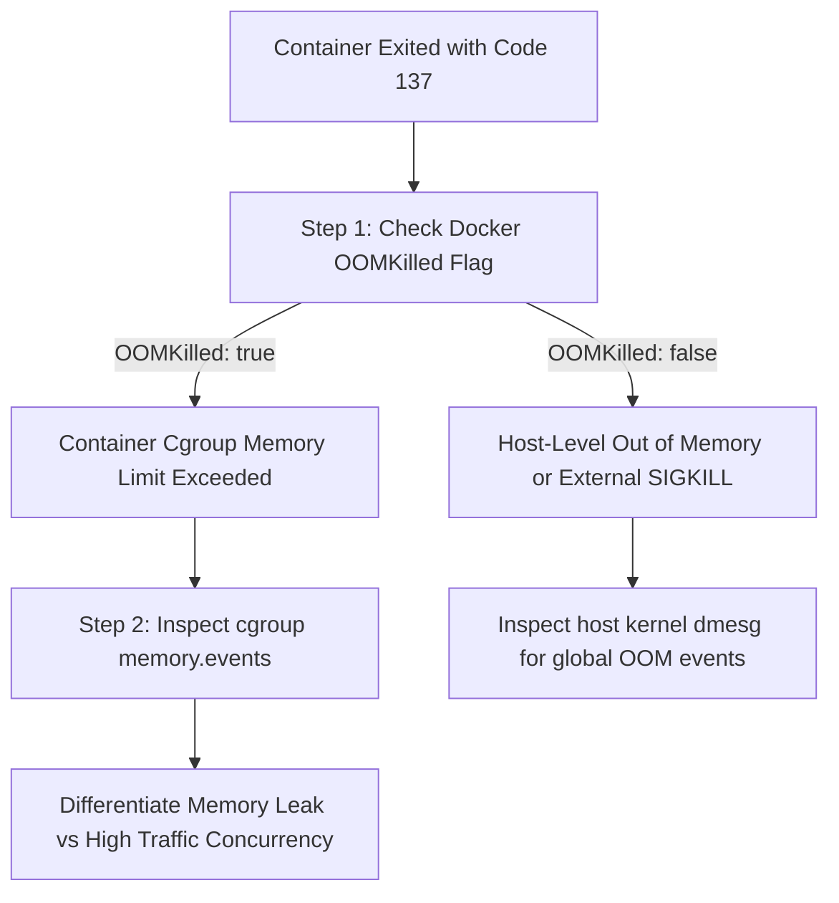

# Operational Runbook: Linux Kernel Cgroup OOM Triage & Mitigation

**Runbook Identifier:** `RB-SYS-OOM`  
**Target Architecture:** Linux Kernel cgroups v2 & Docker Resource Quotas  
**Memory Hard Limits:** Nginx (128 MB) • FastAPI (256 MB) • Redis (128 MB) • Total Stack Ceiling: 512 MB RAM  
**Severity Level:** 🟠 P2 (Degraded Resilience / Service Restart)  
**Target Recovery Time Objective (RTO):** < 8 Minutes  

---

## 1. Incident Overview & Trigger Symptoms

A container suddenly exits or restarts automatically. A client observes intermittent connection resets or 502 responses.

```text
# Docker CLI indicates container exited with status code 137 (128 + SIGKILL 9)
$ docker ps -a
NAMES                 STATUS                        PORTS
inprac_api_service    Exited (137) 12 seconds ago
```

### Underlying Mechanism
When a container process exceeds the strict memory ceiling enforced by the Linux kernel's cgroups controller (`memory.max`), the kernel's Out-Of-Memory (OOM) Killer triggers immediately, sending a non-catchable `SIGKILL` (`kill -9`) to the offending process inside the container namespace to protect host stability.

---

## 2. Differential Diagnostic Tree: Container OOM vs Host OOM



---

## 3. Diagnostic Commands Checklist (Read-Only)

Execute these diagnostic commands on the VPS host:

```bash
# 1. Verify if the termination was specifically an Out-Of-Memory kill
docker inspect inprac_api_service --format 'State: {{.State.Status}} | ExitCode: {{.State.ExitCode}} | OOMKilled: {{.State.OOMKilled}}'

# 2. Inspect kernel cgroup memory event counters (shows exact oom_kill count)
CONTAINER_ID=$(docker inspect inprac_api_service --format '{{.Id}}')
sudo cat /sys/fs/cgroup/system.slice/docker-${CONTAINER_ID}.scope/memory.events 2>/dev/null || docker stats --no-stream inprac_api_service

# 3. Check kernel dmesg ring buffer for OOM killer execution details
sudo dmesg -T | grep -E -i "oom|killed process|out of memory" | tail -n 20

# 4. Verify host memory allocation to confirm host stability
free -m
```

---

## 4. Diagnostic Interpretation Guide

| Metric / Output | Value | Diagnostic Conclusion |
| :--- | :--- | :--- |
| `OOMKilled` | `true` | **Container Cgroup OOM:** The container exceeded its specific allocation (e.g. 256 MB for API). The host OS remains completely healthy. |
| `ExitCode` | `137` | **SIGKILL Received:** The kernel killed the process due to cgroup boundary violation or manual `docker kill`. |
| `ExitCode` | `1` or `2` | **Application Error:** Not memory related (e.g., Python uncaught exception, missing environment variable). |
| `free -m` Available | > 5,000 MB | **Host Protected:** Host has abundant free RAM (~7.3 GB free). The cgroup containment successfully isolated the failure from other host services. |

---

## 5. Mitigation & Stabilization Procedure

> [!IMPORTANT]
> **Do not simply increase the container memory limit as your first response.**  
> Blindly increasing memory caps masks memory leaks and risks violating the strict **Half-VPS Resource Guardrail**. Follow the mitigation hierarchy below:

### Priority 1: Prevent Rapid Container Restart Thrashing
If a container is stuck in an infinite OOM restart loop:
```bash
# Stop the thrashing container temporarily while diagnosing
docker compose stop api
```

### Priority 2: Memory Leak vs Concurrency Analysis
1. Inspect the last 200 lines of application logs before the kill:
   ```bash
   docker logs --tail 200 inprac_api_service
   ```
2. Determine whether the kill occurred due to:
   * **Unbounded Request Payloads:** A client sent a huge multipart form or file upload that overwhelmed buffer limits.  
     *Remediation:* Enforce `client_max_body_size 10m;` in `nginx.conf`.
   * **Unbounded Redis Queries:** The application executed `KEYS *` or retrieved massive unpaginated datasets into memory.  
     *Remediation:* Enforce Redis `maxmemory 96mb` and pagination limits.
   * **Worker Thread Proliferation:** Too many concurrent Uvicorn worker threads running in the container.  
     *Remediation:* Restrict worker threads to 2 workers in Uvicorn startup flags.

### Priority 3: Re-launch and Real-Time Memory Burn-In Test
```bash
# Start container with live telemetry monitoring
docker compose up -d inprac_api_service

# Stream memory utilization during load
docker stats inprac_api_service
```

---

## 6. Post-Remediation Verification Checklist

- [ ] `OOMKilled` returns `false` on current container state: `docker inspect inprac_api_service --format '{{.State.OOMKilled}}'`
- [ ] Memory utilization stabilizes well below 80% of limit (e.g., < 200 MB for API): `docker stats --no-stream`
- [ ] Host memory remains strictly > 7,000 MB free: `free -m`
- [ ] Health diagnostic endpoint returns HTTP 200: `curl -s https://lab.euprac.xyz/health`

---

## 7. Root Cause Analysis (RCA) — 5-Whys Framework

```text
Problem: inprac_api_service terminated with ExitCode 137 and OOMKilled: true.
Why 1: The container memory exceeded its 256 MB cgroup ceiling (memory.max).
Why 2: A sudden surge of 15 concurrent requests triggered memory allocations for large JSON payloads.
Why 3: The FastAPI application loaded complete raw request bodies into memory before streaming to disk.
Why 4: The reverse proxy allowed unbuffered request payloads exceeding 100 MB.
Why 5: Nginx lacked an explicit client_max_body_size restriction on incoming public routes.

Corrective Action: Configured client_max_body_size 10m in nginx.conf and added streaming chunk processors in FastAPI.
```

---

## 8. Customer & Ticket Support Communication Templates

### Template 1: Incident Notification (Zendesk / Discord Ticket)
> *"Hi there,*  
>  
> *We have detected an unexpected process restart on our API service layer and are actively investigating. Our automated kernel cgroups isolated the issue immediately, ensuring no neighboring services or data volumes were impacted.*  
>  
> *We are analyzing process memory profiles to determine root cause and will update you within 15 minutes.*  
>  
> *Best regards,*  
> *Jobin J R — Linux Systems Administrator"*

### Template 2: Resolution & Preventive Update
> *"Hi there,*  
>  
> *The service has been fully stabilized and memory consumption is operating within normal, healthy parameters (under 15% of allocation).*  
>  
> *Our root cause investigation determined that a burst of large payloads caused a transient memory spike, triggering an automated kernel containment restart. We have enforced strict 10 MB payload limits at the reverse proxy edge to prevent future spikes.*  
>  
> *All systems are verified 100% operational.*  
>  
> *Best regards,*  
> *Jobin J R — Linux Systems Administrator"*
