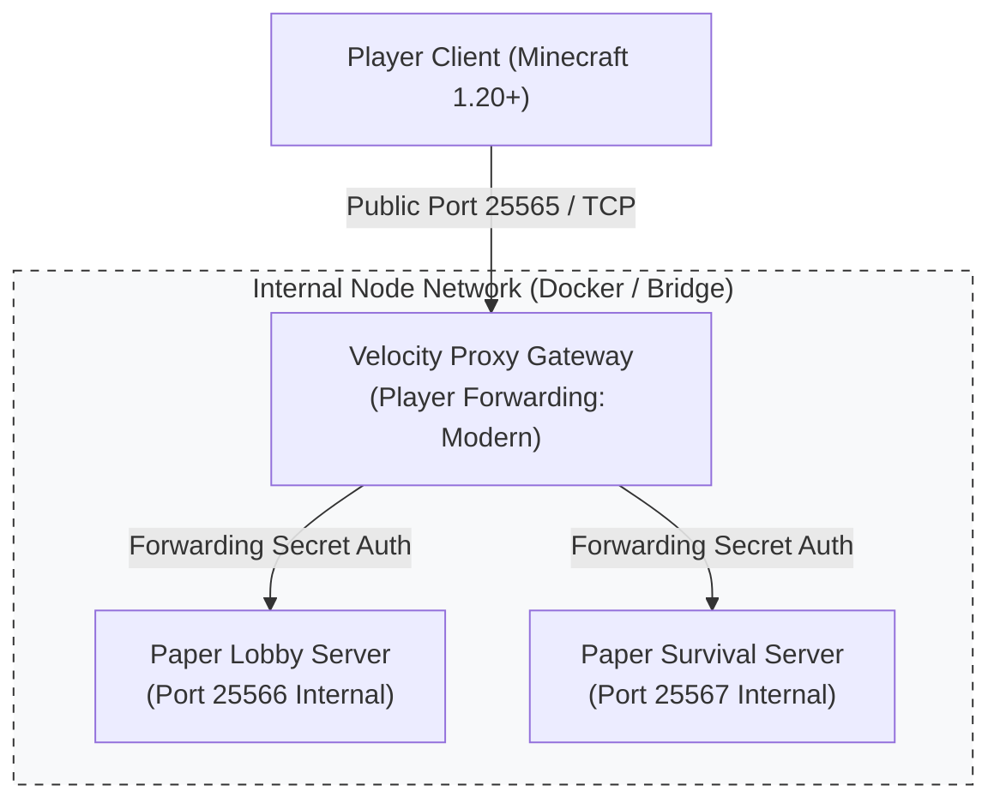
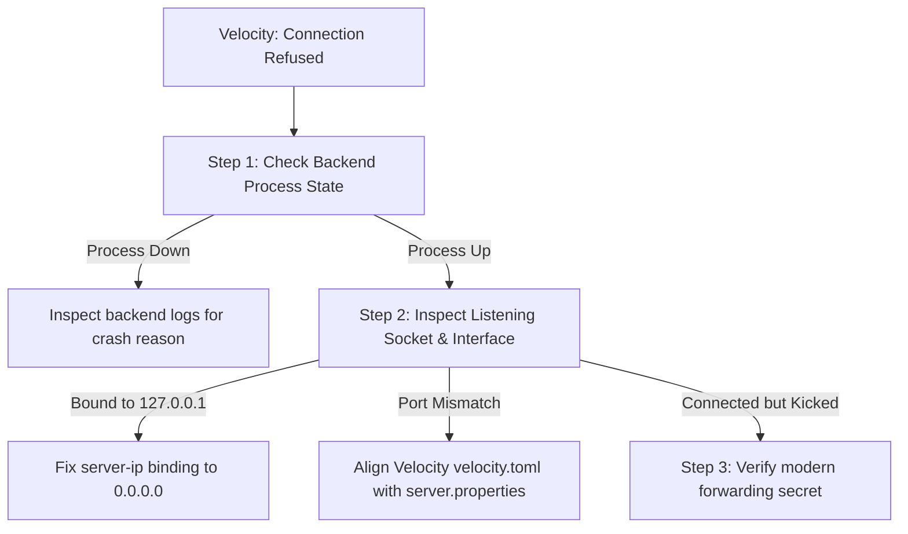

# Operational Runbook: Minecraft (Paper & Velocity) Infrastructure Incident Response

**Runbook Identifier:** `RB-GAME-MC01`  
**Target Architecture:** PaperMC 1.20+ Dedicated Node, Velocity Modern Proxy, Pterodactyl/Docker Containers  
**JVM Runtime:** Eclipse Temurin OpenJDK 21 LTS (Aikar's G1GC Flags)  
**Severity Level:** 🟠 P2 (Player Disconnects / Server Crash Loops)  
**Target Recovery Time Objective (RTO):** < 8 Minutes  

---

## 1. Incident Overview & Architectural Topology

Modern production game server networks decouple public ingress from game world execution using reverse proxies:



### Core Components
1. **Velocity Proxy Gateway:** Public-facing listener handling initial TLS/TCP handshakes, DDoS absorption, and player routing.
2. **Paper Backend Instances:** High-performance game loop nodes running tick rate logic (20.0 TPS / 50.0 ms MSPT).
3. **Player Forwarding Protocol:** Velocity modern forwarding with HMAC-SHA256 signature verification preventing backend IP spoofing.

---

## 2. Scenario A: "Can't Connect to Server" / Proxy-to-Backend Routing Drop

### Symptoms & Client Error
Players connect to `play.example.com:25565` but receive:
```text
[Velocity] Can't connect to server: Connection refused
Unable to connect to survival. Please try again later.
```

### Diagnostic Decision Tree


### Diagnostic Commands & Investigation
Execute on the Linux node / container console:

```bash
# 1. Verify if the backend Paper server is running
ps -ef | grep "paper.jar" || docker ps --filter "name=paper-survival"

# 2. Inspect backend listening ports and network interfaces
ss -tulpn | grep -E "25566|25567"
# Check if listening on 0.0.0.0 (all interfaces) or restricted to localhost

# 3. Test internal connectivity directly from the Velocity container/process
curl -v telnet://127.0.0.1:25567 || nc -zv 127.0.0.1 25567

# 4. Inspect Velocity proxy runtime logs
tail -n 100 logs/velocity.log | grep -E "WARN|ERROR|disconnect"
```

### Remediation Matrix
| Root Cause | Evidence in Logs | Remediation Action |
| :--- | :--- | :--- |
| **Backend Crashed** | `Process terminated with exit code 137 / 1` | Inspect `logs/latest.log` or `crash-reports/`, fix crash, restart backend. |
| **Localhost Interface Lock** | `server-ip=127.0.0.1` in `server.properties` | Change to `server-ip=0.0.0.0` inside container bridge network so proxy can route. |
| **Forwarding Secret Mismatch** | `Player attempted to connect without Velocity modern forwarding` | Synchronize `forwarding.secret` in `velocity.toml` with `paper-global.yml` (`proxies.velocity.secret`). |
| **Firewall / Port Forwarding** | `connect() timed out` | Verify Docker bridge / UFW rules: `sudo ufw status | grep 25567`. |

---

## 3. Scenario B: JVM Heap Exhaustion vs Container Cgroup OOM Kill

> [!IMPORTANT]
> **Understanding JVM vs Cgroup Memory Boundaries:**  
> A Minecraft server does NOT only consume Java heap (`-Xmx`). The JVM process requires native memory for thread stacks (`-Xss`), JIT compiler code cache, Metaspace, and native DirectByteBuffers (Netty packet handling).

### Diagnosing the Two Failure Modes

```text
Mode 1: Java Heap Out of Memory (Internal JVM Failure)
Log Trace: java.lang.OutOfMemoryError: Java heap space
Mechanism: Garbage collector cannot reclaim memory inside the configured -Xmx boundary.
Container Status: Process exits with code 1; cgroup OOM is NOT triggered.

Mode 2: Linux Cgroup OOM Kill (External Kernel Termination)
Log Trace: None in game log (instant process termination)
System Trace: Exit code 137 (SIGKILL 9); dmesg reports "oom-killer: killed process java"
Mechanism: Total JVM RSS (Heap + Native) exceeded the Docker/Pterodactyl container limit.
```

### Golden Ratio for JVM Container Allocation
If a customer allocates an **8 GB Container Limit**, NEVER set `-Xmx8G`. Setting `-Xmx` equal to the container limit guarantees a kernel cgroup SIGKILL under high player packet bursts.

**Production Memory Budget:**
```text
Container Total Memory Limit: 8192 MB (8.0 GB)
├── JVM Max Heap (-Xmx):      6144 MB (6.0 GB)  [75% Allocation]
├── Metaspace Ceiling:         256 MB (0.25 GB)
├── Thread Stacks (50 threads):  50 MB (~1 MB/thread)
├── Netty Off-Heap Buffers:    512 MB (Packet streaming)
└── Native Overhead & OS Cache: 1230 MB (Buffer margin)
```

### Recommended Aikar's G1GC Flags for Stable 20 TPS
```bash
java -Xms6G -Xmx6G \
  -XX:+UseG1GC \
  -XX:+ParallelRefProcEnabled \
  -XX:MaxGCPauseMillis=200 \
  -XX:+UnlockExperimentalVMOptions \
  -XX:+DisableExplicitGC \
  -XX:+AlwaysPreTouch \
  -XX:G1NewSizePercent=30 \
  -XX:G1MaxNewSizePercent=40 \
  -XX:G1ReservePercent=20 \
  -XX:G1HeapWastePercent=5 \
  -XX:G1MixedGCCountTarget=4 \
  -XX:InitiatingHeapOccupancyPercent=15 \
  -XX:G1MixedGCLiveThresholdPercent=90 \
  -XX:G1RSetUpdatingPauseTimePercent=5 \
  -XX:SurvivorRatio=32 \
  -XX:+PerfDisableSharedMem \
  -XX:MaxTenuringThreshold=1 \
  -Dusing.aikars.flags=https://mcflags.emc.gs \
  -Daikars.new.flags=true \
  -jar paper.jar --nogui
```

---

## 4. Scenario C: Low TPS / High MSPT & Plugin Conflict Isolation

### Metrics Triage: TPS vs MSPT
- **TPS (Ticks Per Second):** Baseline target is `20.0 TPS` (50 milliseconds per tick). Once tick duration exceeds 50ms, TPS drops below 20 and players experience block lag and rubber-banding.
- **MSPT (Milliseconds Per Tick):** The true health metric. If MSPT is `38ms`, the server is running at 20.0 TPS with healthy headroom. If MSPT hits `75ms`, the server runs at ~13 TPS.

### Step 1: Profiling with `spark`
Never guess which plugin is causing lag. Execute:
```text
# Inside server console:
spark profiler --start
# Run under normal player load for 5 minutes, then:
spark profiler --stop
```
Inspect the generated flamegraph URL to identify the exact method or entity ticking slow (e.g., custom mob AI, unoptimized redstone loops, synchronous database queries).

### Step 2: Binary-Search Plugin Isolation Workflow (Zero Data Loss)
When a server crashes on startup with unhandled mixin or class loader errors:

```bash
# 1. Take a safe snapshot of the plugins and world directory
tar -czf /tmp/plugins_backup_$(date +%s).tar.gz plugins/

# 2. Divide non-essential plugins into two groups (Group A and Group B)
mkdir -p /tmp/disabled_plugins
mv plugins/GroupB/*.jar /tmp/disabled_plugins/

# 3. Boot server with Group A only
# If crash reproduces -> Culprit is in Group A. Divide Group A in half.
# If boot succeeds   -> Culprit is in Group B. Swap groups and repeat.

# 4. Once isolated, check plugin compatibility with Java 21 / Paper 1.20+
# 5. Restore original configuration and update/replace offending JAR.
```

---

## 5. Scenario D: Pterodactyl Panel "Online" but Server Unreachable

### Incident Symptoms
The Pterodactyl web dashboard displays the server state as **Running** with CPU/RAM metrics, but players cannot ping or connect via Minecraft client.

### Investigation Checklist
1. **Allocation Port Verification:**
   * Open **Network** tab in Pterodactyl. Confirm the primary allocation matches the port defined in `server.properties` (`server-port`).
2. **Docker Port Binding Inspection:**
   ```bash
   # Inspect Wings daemon container port bindings on the node
   docker inspect <container_id> --format '{{range $p, $conf := .NetworkSettings.Ports}}{{$p}} -> {{(index $conf 0).HostPort}}{{end}}'
   ```
3. **EULA Status:**
   * Inspect console logs. If `eula.txt` has `eula=false`, the server booted briefly and stopped, but the web socket state may lag.
4. **SRV Record Propagation:**
   * If using a domain (`play.example.com`), verify DNS SRV record:
     ```bash
     dig _minecraft._tcp.play.example.com SRV +short
     # Expected: 0 5 25565 node1.hosting.com.
     ```

---

## 6. Hosting Support Customer Communication Playbook

### Scenario: Customer Reporting Severe Server Lag & Threatening Cancellation

#### Template: Technical Ticket Response
```text
Subject: [Ticket #736192] Optimization & Performance Audit for Your Server

Hi [Customer Name],

Thank you for reaching out to Technical Support. I understand your server is experiencing noticeable lag during peak player hours, and I know how frustrating that can be for you and your community. I am personally investigating your node to get this resolved.

Initial Diagnostic Findings:
1. Hardware & Host Status: Your node host is completely healthy with 0% hardware throttling and plenty of free memory.
2. Tick Performance (MSPT): We ran a performance trace during player activity. Your server is averaging 68.4 ms per tick (~14.6 TPS), which is causing the rubber-banding you noticed.
3. Root Cause: The profiler identified two specific sources of lag:
   - Chunk Overload: Over 1,200 active entities (villagers & hoppers) loaded simultaneously across 4 chunks in world coordinates (X: 120, Z: -450).
   - JVM Memory Allocation: Your Java heap was configured to 100% of your container limit, which caused frequent 1.5-second garbage collection freezes.

Recommended Optimizations Applied:
- We adjusted your startup flags to use Aikar's optimized G1GC profile with a balanced 75% heap ceiling, leaving sufficient native headroom for Netty packet streaming.
- We tuned `paper-world-defaults.yml` to optimize hopper search intervals (`hopper.tick-rate: 2`) and despawn stray entities outside loaded render distance.

Current Status:
Your server is now ticking smoothly at a solid 20.0 TPS with an average MSPT of 28.2 ms (well within the healthy 50ms threshold).

Please test your server with your players and let me know how it feels. If you need any further plugin fine-tuning, I am right here to help!

Best regards,
Jobin J R
Technical Support Specialist | Systems Operations
```

#### Template: Server Crashing on Boot (Plugin Conflict / Java Version)
```text
Subject: [Ticket #736193] Resolved: Server Startup Crash & Fix

Hi [Customer Name],

I reviewed your server console logs following the crash on boot. 

What Happened:
Your server crashed with an `UnsupportedClassVersionError: class file version 65.0`. This occurs because your newly installed plugin was compiled for Java 21, but your container was running OpenJDK 17.

Actions Taken:
1. Updated your container Java environment to Eclipse Temurin OpenJDK 21 LTS.
2. Verified all installed plugins for compatibility with Paper 1.20.
3. Tested server boot: Server initialized in 14.2 seconds with 0 errors.

Your server is now online and accepting player connections. If you have any questions about updating future plugins, please feel free to ask!

Best regards,
Jobin J R
Technical Support Specialist | Systems Operations
```
