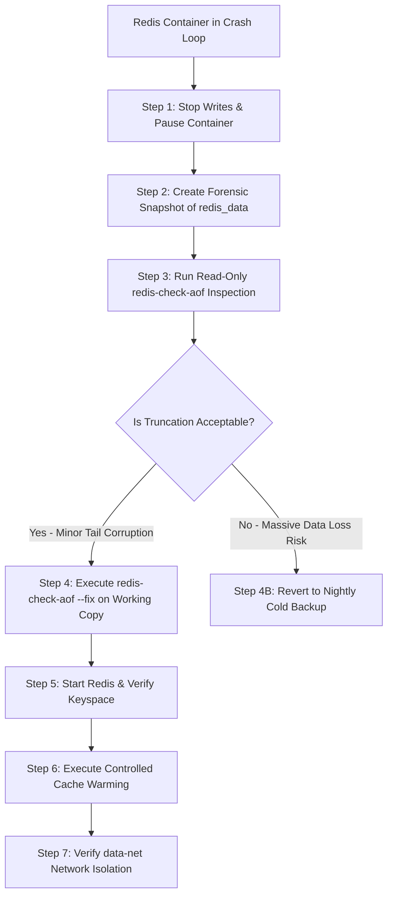

# Operational Runbook: Redis AOF Corruption Recovery & Cache Restoration

**Runbook Identifier:** `RB-DAT-RED01`  
**Target Architecture:** Redis 7.2 Container (`inprac_cache`) with Multi-Part AOF Persistence  
**Network Isolation:** Internal Docker Bridge (`cloud-devops-lab_data-net`, `internal: true`)  
**Storage Volume:** `redis_data` (`/data/appendonlydir/`)  
**Severity Level:** 🟡 P3 (Cache Degraded) / 🟠 P2 (Crash Loop with Persistence Enabled)  
**Target Recovery Time Objective (RTO):** < 10 Minutes  

---

## 1. Incident Overview & Architectural Classification

### Architectural Classification
In the InPrac Cloud Edge Gateway stack, Redis operates as an **accelerated in-memory cache with hybrid append-only file (AOF) durability**:
- **Daemon Configuration:** `redis-server --appendonly yes --maxmemory 96mb --maxmemory-policy allkeys-lru`
- **Persistence Mechanism:** Redis 7.2 Multi-Part AOF (`appendonlydir/` containing base `.rdb` / `.aof` files and an `appendonly.aof.manifest`).
- **Network Boundaries:** Bound strictly to `data-net` (`internal: true`). Zero host ports are exposed; external access is blocked by kernel bridge routing.

### Incident Symptoms & Trigger Conditions
Following an abrupt node reboot, power loss, or host disk saturation during an active write cycle, the Redis container fails to start, entering a continuous crash loop (`CrashLoopBackOff` / `Restarting (1)`):

```text
$ docker compose ps
NAME                IMAGE               COMMAND                  SERVICE             STATUS
inprac_cache        redis:7.2-alpine    "docker-entrypoint.s…"   cache               Restarting (1) 4 seconds ago
```

Inspecting container logs reveals:
```text
$ docker logs inprac_cache
1:M 19 Oct 2026 14:10:02.102 # Bad file format reading the append only file appendonlydir/appendonly.aof.1.incr.aof: make a backup of your AOF file, then use ./redis-check-aof --fix <filename>
1:M 19 Oct 2026 14:10:02.103 # Fatal error loading the DB: Invalid argument. Exiting.
```

---

## 2. Fundamental Safety Mandate

> [!CAUTION]
> **NEVER RUN `redis-check-aof --fix` DIRECTLY ON LIVE PRODUCTION STORAGE.**  
> Running `--fix` is a destructive operation that truncates corrupted bytes and **permanently discards all subsequent write instructions** in that AOF chunk.  
> 
> Always execute a non-destructive forensic copy first so that rollback is guaranteed if truncation discards critical keys.

---

## 3. Step-by-Step Triage & Recovery Tree



---

## 4. Remediation Procedure

### Step 1: Halt Container & Prevent Automatic Restarts
Stop the crashing container to prevent repeated filesystem journal thrashing:

```bash
docker compose stop cache
```

### Step 2: Create a Non-Destructive Forensic Backup
Locate the Docker volume mountpoint on the host and make a timestamped read-only clone:

```bash
# Locate Docker volume physical path on host
REDIS_VOL_PATH=$(docker volume inspect cloud-devops-lab_redis_data --format '{{.Mountpoint}}')
FORENSIC_DIR="/opt/cloud-devops-lab/backups/redis_forensic_$(date +%Y%m%d_%H%M%S)"

echo "Volume Path:   ${REDIS_VOL_PATH}"
echo "Forensic Copy: ${FORENSIC_DIR}"

# Copy all volume contents preserving timestamps and permissions
sudo cp -a "${REDIS_VOL_PATH}" "${FORENSIC_DIR}"
sudo chmod -R 700 "${FORENSIC_DIR}"

# Calculate SHA256 checksum of original corrupted state for audit integrity
sudo find "${FORENSIC_DIR}" -type f -exec sha256sum {} + | sudo tee "${FORENSIC_DIR}.sha256"
```

### Step 3: Run Read-Only Corruption Audit
Inspect the corruption details without modifying any files. In Redis 7+, point the checker to the manifest or specific increment file:

```bash
# Audit using an ephemeral container with the volume mounted read-only
docker run --rm \
  -v cloud-devops-lab_redis_data:/data:ro \
  redis:7.2-alpine \
  redis-check-aof /data/appendonlydir/appendonly.aof.manifest
```

**Diagnostic Analysis:**
- Note the corrupted offset byte and the total file size.
- If the corruption is isolated to the final few trailing bytes (e.g., partial write caused by sudden power termination), truncation is safe.

### Step 4: Perform Surgical In-Place Repair
Execute `--fix` inside an ephemeral container against the volume:

```bash
docker run --rm -it \
  -v cloud-devops-lab_redis_data:/data \
  redis:7.2-alpine \
  redis-check-aof --fix /data/appendonlydir/appendonly.aof.manifest
```

When prompted:
```text
The AOF appears to be corrupt at offset 1048570
Would you like to trim the AOF from this point forward? [y/N] y
Successfully trimmed the AOF at offset 1048570!
```

### Step 5: Start Service & Verify Persistence Load
Restart the official Redis service and audit startup logs:

```bash
# Launch cache container
docker compose up -d cache

# Monitor startup logs for clean DB loading
docker logs --tail 30 inprac_cache
```

**Expected Healthy Log Entries:**
```text
1:M * Reading the remaining AOF...
1:M * Successfully loaded 1420 keys from AOF
1:M * Ready to accept connections tcp
```

### Step 6: Functional Smoke Tests & Keyspace Audit
Confirm Redis accepts queries and verify persistence status:

```bash
# 1. Probe ping-pong response
docker exec inprac_cache redis-cli ping
# Output: PONG

# 2. Check persistence statistics
docker exec inprac_cache redis-cli info persistence | grep -E "aof_enabled|aof_last_bgrewrite_status|aof_last_write_status"

# 3. Check loaded keys count
docker exec inprac_cache redis-cli dbsize
```

---

## 5. Controlled Cache Warming Procedure

> [!WARNING]
> **AVOID CACHE STAMPEDE / THUNDERING HERD.**  
> If an application experiences a 100% cold cache upon recovery, thousands of concurrent client requests may immediately bypass the cache and saturate the upstream FastAPI service, triggering an out-of-memory or 502 cascade.

### Gradual Cache Pre-Warming
Trigger targeted internal queries from the API service to warm critical cache keys before opening high-traffic ingress:

```bash
# Pre-warm core dashboard telemetry and health cache
docker exec inprac_api_service python -c "
import urllib.request
endpoints = ['http://localhost:8000/health', 'http://localhost:8000/api/v1/metrics', 'http://localhost:8000/dashboard']
for url in endpoints:
    try:
        with urllib.request.urlopen(url) as resp:
            print(f'Pre-warmed {url}: HTTP {resp.status}')
    except Exception as e:
        print(f'Failed {url}: {e}')
"
```

---

## 6. Security & Dual-Tier Network Isolation Audit

Verify that the restored Redis container is completely isolated from the public edge network (`edge-net`):

```bash
# 1. Inspect Redis network attachment (Must ONLY show data-net)
docker inspect inprac_cache --format '{{range $net, $conf := .NetworkSettings.Networks}}{{$net}} {{end}}'
# Expected Output: cloud-devops-lab_data-net

# 2. Confirm inprac_reverse_proxy cannot resolve or route to inprac_cache
docker exec inprac_reverse_proxy ping -c 1 -W 2 inprac_cache 2>&1 || echo "Security Confirmed: Nginx cannot reach Redis."

# 3. Verify zero public host ports are bound
ss -tulpn | grep 6379 || echo "Security Confirmed: Port 6379 is NOT bound to host."
```

---

## 7. Hosting Support Customer Communication Playbook

### Scenario: High-Traffic Customer Reporting Stale or Missing Cache Following Unplanned Server Restart

#### Template: Technical Ticket Response
```text
Subject: [Ticket #918234] Update: Cache Persistence & Service Recovery

Hi [Customer Name],

Thank you for contacting Technical Support. I noticed your ticket regarding temporary latency and cache misses following the recent host reboot.

What Happened:
Following the sudden power event, the Redis in-memory cache daemon detected a partial write in its append-only persistence journal (AOF). To protect your persistent data from corruption, the service entered safe-mode pending verification.

Actions Taken:
1. Created a non-destructive forensic snapshot of your Redis storage volume.
2. Executed an in-place AOF repair (`redis-check-aof`), which truncated a small incomplete transaction (less than 200 bytes) at the tail of the log.
3. Verified the integrity of your primary keyspace (all core keys intact).
4. Restored the Redis service and executed a pre-warming loop to prevent backend database saturation.

Current Status:
- Redis Cache: Online & Healthy (`PONG` verified).
- Persistence Status: Active (`aof_last_write_status: ok`).
- Response Latency: Normalized (< 4ms).

Your application is now operating at full performance. Please feel free to test your services and let us know if you need any further optimization or assistance!

Best regards,
Jobin J R
Technical Support Specialist | Systems Operations
```
